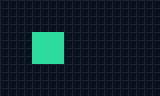
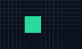
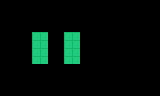

<!-- SPDX-License-Identifier: MIT -->
# Cassini

Cassini is a debugging toolkit for Sega Saturn emulators and recompiled games.
It turns graphics captures, images and hardware logs into local reports that
developers and coding agents can inspect and compare.

Use it to connect a changed graphics command or layer setting to a pixel
difference, find which hardware features a route exercises, or keep a native
versus original investigation reproducible. Emulator developers can export the
[neutral capture format](docs/formats.md) and use the same comparison tools.
Game profiles supply paths, identities and adapters for other input formats;
Grandia is the first validated profile.

## Try it without a game

Use Python 3.11+ with Pillow already available. From this folder, run:

```text
python -B examples/demo.py --out ../cassini-demo
```

This creates two synthetic captures, inspects them, compares their fields and
pixels, and summarizes a synthetic hardware log. Everything goes into a new
folder outside the kit. Nothing is downloaded, installed, built or launched
except Python analysis commands. Choose a fresh output name for another run.

| Before | After | Pixel difference |
| --- | --- | --- |
|  |  |  |

The example reports:

```text
State: /vdp1/commands/0/x changed from 32 to 48
Image: 1024 different pixels; no missing or added pixels
Hardware log: 2 counter keys; no CPU-time inference
```

These are hand-generated shapes and declared example fields. The demo does
**not** run the production renderer, emulate Saturn drawing, or establish a
real game's correctness. Open `demo-summary.json` and the JSON/PNG reports in
the output folder to see the actual results.

## Use your own captures

The CLI and typed stdio MCP server share these operations:

| Command | Purpose |
| --- | --- |
| `inspect` | Inspect neutral captures, or use a configured graphics decoder/production renderer. |
| `diff` | List changed, added and missing fields and compare every image pixel. |
| `hw-report` | Summarize closed hardware/guest logs without treating counts as CPU time. |
| `replay` | Plan a bounded native replay; execution requires explicit opt-in. |
| `capture-original` | Plan original-emulator capture through the research bridge; execution requires explicit opt-in. |
| `saves` | Inspect metadata or explicitly transport supported saves into fresh output. |
| `audio-gaps` | Inspect PCM silence, or compare generated/delivery evidence with the audio add-on. |

The demo creates a working profile. Make another inspection with:

```text
python -B cassini.py inspect --profile ../cassini-demo/profile.json --input inputs/before.json --out results/another-inspection
python -B cassini.py --help
```

Operation paths resolve against the profile's directory. A profile declares
the game, allowed input roots and an output root inside them; each run needs a
new child output directory. Filled profiles, captures and results belong
outside this kit. See the inert [game profile example](profiles/grandia.example.json)
and [format reference](docs/formats.md) when connecting a real producer.

The MIT core reads represented state and verifies referenced files; it does
not guess a decoder for an arbitrary emulator state. The optional
[renderer add-on](addons/gpl-renderer/README.md) supplies the existing graphics
inspector and production compositor. Original states also need a compatible
reader and paired capture. Use the explicit build recipes and existing
dependencies; nothing builds automatically. Optional audio analysis also needs
NumPy already available.

## View and export textures

The renderer add-on's `textures` command shows every texture a frame's VDP1
command list uses, with its VRAM address, and saves each one as a PNG plus raw
bytes, along with a page to browse them. It works from Ymir's
**Debug > Dump all memory** or any emulator's saved video memory; no
recompiled game is needed. See
[View and export textures from an emulator](addons/gpl-renderer/README.md#view-and-export-textures-from-an-emulator).

## Connect an agent

Configure an MCP client to launch the server with absolute paths:

```text
python -B /path/to/Cassini/cassini.py mcp --profile /path/to/private/profile.json
```

The server keeps its selected profile and refuses changes during the session.
Restart deliberately to change its game or permissions. This folder is also a
Claude Code plugin: load it explicitly with `--plugin-dir` pointing here. Its
`.mcp.json` uses an existing Python runtime and the private `CASSINI_PROFILE`
environment variable. [AGENTS.md](AGENTS.md) provides the same workflows for
Codex and other agents. No global client configuration is edited.

## Evidence and permissions

Analysis preserves inputs and writes fresh reports. Diffs cover whole images
and represented fields; matching names or scenes do not prove equivalent
gameplay. DRAW, physical DISPLAY and static reconstruction remain distinct.
Save transport does not infer progress or validate game checksums, and silence
alone does not prove an audio delivery fault.

Replay and original capture default to plans. `--execute` runs only the
profile-pinned controller with finite frame/wall bounds and disposable save or
emulator-profile copies. Use a closed copy as the seed. The controller owns its
children, refuses arbitrary RAM writes/state import, and does not take over an
already running player. Another game's integration needs its own checks.

The core and new workflows are MIT; optional GPL add-ons preserve their donor
licences. Game data, BIOS, real saves/captures and compiled player/emulator
binaries are not shipped. See [licensing](docs/licensing.md),
[inventory](docs/inventory.md) and [architecture](docs/architecture.md).

Run `python -B -m unittest discover -s tests -v` for synthetic tests and
`python -B check_provenance.py` for shipped per-file identities and licences.
Review corresponding-source obligations before redistributing GPL components.

Existing integrations keep the `saturn_kit` module, `saturn-kit-*` schemas,
`saturn-*` skill names and `saturn-kit.py` launcher alias for compatibility.
Client launch paths/server names use Cassini; old plugin configurations must
rename `SATURN_KIT_PROFILE` to `CASSINI_PROFILE` and restart. Filled source and
executable pins must match the local installation.
